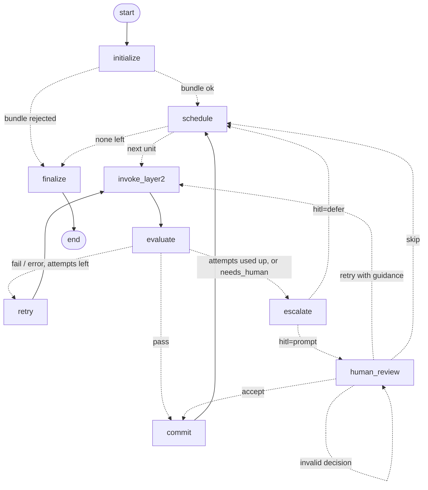

# Layer 1: deterministic orchestration (LangGraph)

Layer 1 sits between Layer 0 (static analysis) and Layer 2 (the agents):
1. It takes Layer 0's bundle.
2. It schedules the fragments bottom-up, in Layer 0's migration order.
3. It sends each one to Layer 2 and judges the verdict that comes back.
4. It commits the fragment, retries it, or escalates it to a human.
5. At the end, it assembles the **migrated codebase** and writes the reports and logs.

The proposal asks for a *finite-state machine with explicitly typed transitions, strict retry bounds (max 3 per unit) and a human-in-the-loop escalation gate*. That is what this is, built with LangGraph:

| architecture box | node(s) | what happens |
|---|---|---|
| Input from Layer 0 | `initialize` | Load the bundle and **re-validate it against the original sources** (Layer 0's 10 contract checks). Refuse it if any check fails. Plan one *unit* per migration step |
| Initialize workflow | `initialize` | Set every fragment to `pending` and zero the counters |
| Schedule next fragment | `schedule` | Take the next unit in migration order. Skip vendored code (e.g. a bundled `six.py`) and code outside `--scope` (status `out_of_scope`). **Block** a unit if any of its dependencies did not migrate. Blocked units are never sent |
| Invoke Layer 2 | `invoke_layer2` | Build the request: the unit's fragments, their **already-migrated dependencies with their translations**, the target API, and the feedback of earlier attempts. Then call Layer 2 |
| Evaluate result | `evaluate` | Check the verdict against the request (schema, unit, attempt, a translation for every fragment, safe paths, slots). An invalid "pass" counts as a failed attempt |
| Decision: match? | `decide` (routing) | pass → `commit`. fail/error with attempts left → `retry`, carrying the feedback. Otherwise, or if Layer 2 says `needs_human` → `escalate` |
| Human-in-the-loop (optional) | `escalate`, `human_review` | `--hitl defer`: record the case and move on; the unit's dependents get blocked. `--hitl prompt`: pause (LangGraph `interrupt`) for a decision: **accept** a hand-written translation, **retry** with guidance (a fresh budget of attempts), or **skip**. The reviewer sees an **escalation brief** written by an LLM (below) |
| Final output | `finalize` | Assemble the migrated codebase. Write `state.json`, `translations.jsonl` and `escalations.json`. The CLI then validates the run, compiles the output in the sandbox and writes `report.md`, which opens with a summary written by an LLM (below) |

Two Layer 2s plug in: the **agents** (`--layer2 agents`, [layer2/README.md](../layer2/README.md)), which translate, test differentially in Docker and repair; and a **dummy** ([`layer2/dummy.py`](../layer2/dummy.py), the default), which passes every unit without translating and is how Layer 1 itself is tested.

## Setup and run

Layer 1 needs LangGraph, so unlike the rest of the repo it needs packages (Python 3.10+):

```bash
python -m venv .venv
.venv/Scripts/python -m pip install -r requirements.txt     # Windows; .venv/bin/python on Linux / macOS
```

From the repository root, with Docker running (Layer 0 and the build check use the sandbox images):

```bash
.venv/Scripts/python -m layer1 --verify            # known-answer scenarios (expect "30/30 known-answer checks passed")
.venv/Scripts/python -m layer1                     # Layer 0 on its 3 test pairs, then Layer 1 on each bundle
.venv/Scripts/python -m layer1 --target python3    # the same, with a Python 3 target (splice assembly)
.venv/Scripts/python -m layer1 --bundles logs/layer0/<run> [REPO ...]   # reuse existing Layer 0 bundles
.venv/Scripts/python -m layer1 --resume logs/layer1/<run>/<repo>         # continue a crashed or paused run
```

| option | default | |
|---|---|---|
| `--max-attempts N` | 3 | Layer 2 attempts per unit before escalating (the proposal's bound) |
| `--hitl defer\|prompt` | `defer` | Record escalations and go on, or ask on stdin. A terminal or piped answers both work; with no input left, the run pauses until `--resume` |
| `--vendored skip\|migrate` | `skip` | Bundled third-party code, e.g. json-rpc's `six.py` |
| `--layer2 dummy\|agents` | `dummy` | Which Layer 2. `agents` needs `GROQ_API_KEY` and Docker |
| `--max-repairs N` | 2 | agents: Repair rounds within one attempt |
| `--scope ID` (repeatable) | all | Migrate only fragments matching ID (a fragment id, a module / class / function prefix, or an fnmatch pattern) and everything they depend on. The rest is `out_of_scope`: decided without Layer 2, like vendored code. `plan.json` records each unit's `in_scope` |
| `--dummy-fail ID[=ACTIONS]` | | Make the dummy misbehave on a fragment, e.g. `pkg.mod.f=fail,pass`. Actions: `pass fail error needs_human malformed raise`; the last action repeats, so the default is always `fail` |
| `--no-build-check` | | Skip compiling the migrated codebase |
| `--llm auto\|groq\|gemini\|off` | `auto` | LLM for report summaries and escalation briefs: `auto` chains every provider with a key (`GROQ_API_KEY`, `GEMINI_API_KEY`), else templates. Naming a provider makes it required |
| `--llm-model M` | see below | the first provider's model; if the key cannot use it, a fallback is used and recorded |

## The state machine



(`graph.mmd` in every run is this graph as LangGraph itself draws it.)

**Determinism.**
- The state is a typed dict of JSON values.
- Every node returns only what it changes. Reducers merge the per-fragment status, per-unit log, translations, escalations and counters.
- A transition number `seq` orders every decision.
- Nothing in the state depends on the clock, so two runs with the same Layer 2 give identical `state.json`, `translations.jsonl`, requests and codebase. `--verify` checks this.

**Checkpoints.**
- Every transition is checkpointed to `checkpoints.sqlite` (LangGraph's `SqliteSaver`).
- A run that crashes, or pauses for a human, continues with `--resume` exactly where it stopped. Units already decided are not sent again.
- The file is deleted when a run finishes.

**Termination.** Every loop is bounded:
- at most `max_attempts` attempts per budget;
- at most 2 human-granted extra budgets per unit;
- LangGraph's recursion limit is set from those bounds.

### Scheduling rules

- **A unit is one migration step:** one fragment, or a whole strongly connected component. A cycle is sent as one unit, because mutually recursive code must be migrated together.
- **Units run one at a time, in step order.** Layer 0's order puts every dependency in an earlier step, so when a unit is scheduled, all its dependencies are already decided.
- **Vendored units** (every fragment flagged `vendored`) are skipped and count as satisfied. The vendored library is assumed to be provided, not migrated.
- **Blocking.** If a dependency was escalated, or is itself blocked, the unit is `blocked`. It is never sent. It records `blocked_by` (its direct unsatisfied dependencies) and `root_causes` (the escalated fragments behind them).
- **Retries.** Each attempt after the first carries the feedback of every earlier attempt: outcome, reason, Layer 1's problems with the verdict, and evidence such as the failing tests.
- **What happens to a unit:**

  | Layer 2's answer | result |
  |---|---|
  | `pass` | committed (if the verdict is valid) |
  | `fail` / `error` / invalid verdict / exception | retried while attempts remain, then escalated as `retries_exhausted` |
  | `needs_human` | escalated at once |

  A Layer 2 exception is a failed attempt, not a failed run.

## The Layer 1 ↔ Layer 2 protocol

Protocol `acm-layer1-layer2` 1.0. The models are in [`protocol.py`](protocol.py), and the JSON schemas are [`schemas/translation_request.json`](schemas/translation_request.json) and [`schemas/verdict.json`](schemas/verdict.json). `--verify` checks the schemas still match the models. Layer 2 is any object with `name` and `process(request: dict) -> dict` ([`layer2/__init__.py`](../layer2/__init__.py)). It receives a deep copy, so it cannot change Layer 1's state.

**Request** (one per attempt; saved as `units/<unit>/attempt-<n>/request.json`)

| field | content |
|---|---|
| `unit`, `step`, `wave`, `cycle` | which unit, and where it sits in the order |
| `attempt`, `max_attempts` | this attempt, and the last one before escalation |
| `migration`, `assembly` | regime from the Layer 0 manifest; `splice` (Python target) or `compose` (Java target) |
| `target` | Java: `package`, plus the `expected_api` entries of the classes the unit's `target_hints` name |
| `fragments` | the unit's Layer 0 fragment records, verbatim: source, signature, hazards, branch conditions, features, hints, ... |
| `dependencies` | every fragment the unit depends on: `id`, `kind`, `edge_kinds` (call, inherit, member, ...), `status` (`migrated` / `vendored`), `signature` and **its committed translation** |
| `feedback` | one entry per earlier attempt: `outcome`, `reason`, `problems`, `evidence` |
| `human_guidance` | text from a human `retry` decision |

**Verdict** (saved as `verdict.json`; Layer 1's judgment of it as `evaluation.json`)

| field | content |
|---|---|
| `unit`, `attempt`, `protocol` | must match the request |
| `outcome` | `pass` / `fail` / `error` / `needs_human` |
| `translations` | required for `pass`: a list of *pieces* `{fragment, target_file, code, section, slot, scaffold}` |
| `evidence` | `compiled`, `tests_generated` / `passed` / `failed`, `failing`, `log_dir`, `notes` |
| `trace`, `usage` | per-agent steps, and tokens / seconds, for the reports |

**Pieces and assembly.** These are deterministic; [`assemble.py`](assemble.py) implements them.
- **splice** (Python target):
  - one piece per fragment, written over the fragment's own lines in its own file;
  - comments and blank lines between fragments are kept;
  - a multi-segment fragment (e.g. a property getter + setter) may return one part per segment, joined by Layer 0's `# ...` separator line;
  - a fragment that was not migrated keeps its original code under an `# ACM: not migrated (<status>)` marker.
- **compose** (Java target): Layer 2 decides the target files.
  - A piece opens a named slot with a comment line `// @acm:slot NAME`. Pieces with `slot: NAME` are inserted there, re-indented, in source order. This puts methods into their class and functions into their module class.
  - `preamble` pieces (`package`, `import`) go first, de-duplicated line by line.
  - `scaffold` pieces (e.g. the class holding a module's functions, which any of its functions may create) are kept once.
  - The evaluator refuses:
    - unsafe paths (`..`, absolute);
    - a slot that is not open;
    - a slot opened twice;
    - a missing translation.

## The dummy Layer 2

[`layer2/dummy.py`](../layer2/dummy.py) passes every unit. Its evidence says it ran no tests.
- **Python target:** returns each fragment's source unchanged. The spliced codebase must therefore equal the original byte for byte, which is a strong end-to-end check of the assembler.
- **Java target:** returns **compilable stubs**:
  - one class per Python class, `extends` its migrated internal base;
  - one `<Name>Module` class per module, `<Name>Package` for an `__init__.py`, holding its functions as static methods;
  - constructors for `__init__`;
  - method bodies that throw `UnsupportedOperationException`.

  Names are made Java-safe (`double` → `double_`) and de-duplicated (json-rpc's two `JSONRPCAPI` classes → `JSONRPCAPI`, `JSONRPCAPIFlask`). It is a stand-in for the target skeleton.
- **`script`:** makes chosen fragments fail, error, raise, return malformed verdicts, ask for a human, or crash the process. `--verify` uses this to drive every branch of the state machine.

## LLM-written report text

Reports are generated without anyone writing them. An LLM (Groq, or Gemini as fallback) writes two kinds of prose; everything else in a report is computed:

| text | when | where |
|---|---|---|
| **run summary**: outcome, then what needs attention | once per repo, after validation and the build check | top of `report.md`; full record in `report_summary.json` |
| **escalation brief**: what failed, the likely cause, the reviewer's options (with suggested guidance) and how many units a skip would block | once per escalation, inside the `escalate` node | shown in the `--hitl prompt`; `units/<unit>/brief.json`; `report.md` |

**The LLM never makes a decision.** Scheduling, verdict checks, retries, escalation and blocking stay deterministic. Briefs are kept out of the graph state, so `state.json` is reproducible with or without an LLM.

**Every text is checked against the facts it was written from** ([`llm.py`](llm.py)). The model gets a JSON of facts: counts, statuses, the contract, the build, the escalations, or for a brief the unit's source, hazards and the outcome of each attempt. Its answer is rejected if:
- a number does not occur in the facts; percentages are supplied, so none need computing;
- an identifier in backticks does not occur in the facts. For briefs, this applies only to the project's own names (`itsdangerous.…`) and unit ids, so a brief may suggest a Java API;
- it is too long, or starts with a heading.

A rejected answer is retried once, with the problems listed. If the retry is also rejected, a deterministic template is used. Every report states which happened and which model wrote the text. Without a key (`--llm off`, or offline), the templates are used, and runs and `--verify` work the same.

**Providers and models.** Two providers are supported. Their keys live in the environment or the repo's `.env`, which is git-ignored. Keys are never written to a log, and `--verify` scans every log for both.

| provider | key | model setting | default → fallbacks |
|---|---|---|---|
| Groq | `GROQ_API_KEY` | `ACM_GROQ_MODEL` (or `ACM_LLM_MODEL`) | `llama-3.1-8b-instant` (the project's choice) → `openai/gpt-oss-20b`, `qwen/qwen3.8-27b`, `openai/gpt-oss-120b` |
| Gemini | `GEMINI_API_KEY` | `ACM_GEMINI_MODEL` | `gemini-3.5-flash-lite` → `gemini-3.1-flash-lite`, `gemini-3.8-flash` |

How the providers and models are used:
- **Chain.** `--llm auto`, the default, chains every provider that has a key, in the order `ACM_LLM_PROVIDERS` (default `groq,gemini`). A call that fails on one provider (outage, rate limit) is answered by the next.
- **Probe.** At start, each provider's model is probed with a tiny request, because a listed model can still be retired or unpaid. A provider that cannot generate is reported once and skipped. A billing or key error (HTTP 401/402/403) later in a run drops that provider for the rest of the run.
- **One provider.** `--llm groq` or `--llm gemini` uses only that one, and fails if it doesn't work. `--llm-model` sets the first provider's model.
- **Generation settings.** Temperature 0. Reasoning is kept to a minimum: gpt-oss `reasoning_effort=low`, qwen reasoning hidden, Gemini `thinkingLevel=minimal`.
- **Rate limits.** HTTP 429 and 5xx are retried after the provider's `retry-after` or `retryDelay`. A daily quota is not retried.
- **Logging.** Every call (provider, model, prompt, answer, token usage) is logged to `<repo>/llm/calls.jsonl`.

**How the models were chosen.** As of 2026-10-09: `python -m layer1.llm_bench` makes every candidate write this project's two real texts, the json-rpc / itsdangerous run summary and escalation brief. Latest results are in `logs/llm_bench/`:

| candidate | result |
|---|---|
| Groq `llama-3.1-8b-instant` | **HTTP 404**: not available to this key |
| Groq `openai/gpt-oss-20b` | both texts accepted on the 1st call, ~0.6 s each; complete counts, concise |
| Groq `qwen/qwen3.8-27b` | both accepted on the 1st call, ~0.6 s; the most careful brief (says when the cause is unclear) |
| Groq `openai/gpt-oss-120b` | both accepted on the 1st call, ~1 s |
| Gemini, every model incl. Gemma | **HTTP 402: "Your prepayment credits are depleted"**. The key authenticates and lists 45 models, but its AI Studio project has no prepaid credit, so nothing can generate |
| Gemini `gemini-2.5-flash`, `-flash-lite` | **HTTP 404**: "no longer available to new users"; Google names 3.8-flash / 3.5-flash-lite as replacements |

The decision follows the measurements:
- Groq goes first. `openai/gpt-oss-20b` is the working model nearest the project's intended 8B "lightweight glue" tier, and it wrote accurate, complete text.
- Gemini is wired in as the fallback, with `gemini-3.5-flash-lite`: Google's successor to the flash-lite tier, and the same lightweight class.
- It becomes active by itself once credits are added at ai.studio/projects. Rerun `python -m layer1.llm_bench` then.
- If Gemini writes better text, set `ACM_LLM_PROVIDERS=gemini,groq` in `.env`.

Two problems found while testing, both fixed:
- gpt-oss writes narrow no-break spaces and non-breaking hyphens (`OpenJDK\u202f17`). These made correct text fail the check, and crashed a Windows console when printed. Text is now normalised before checking, and console output tolerates any character.
- The first brief rule rejected a sensible suggestion, `Base64.getEncoder().encodeToString`, because a Java API is never in the Python facts. That led to the project-names-only rule above.

## Output

`logs/layer1/<timestamp>[-label]/`:

```
<repo>/
├── run.json                    bundle, source, options (what --resume needs)
├── plan.json                   the units, in order
├── events.jsonl                every transition: node, unit, attempt, outcome, timing
├── units/<unit>/attempt-<n>/   request.json  verdict.json  evaluation.json
├── units/<unit>/brief.json     escalated units: the brief for the reviewer
├── state.json                  final status of every unit and fragment, counters, assembly result
├── translations.jsonl          committed translation per fragment, and who supplied it (layer2 / human)
├── escalations.json            every escalation, with its final outcome
├── migrated/                   THE MIGRATED CODEBASE
├── validation.json             run contract (below)
├── build_check/                does migrated/ compile? (javac, or CPython's compiler, in the sandbox)
├── report.md                   human-readable report, opening with the LLM-written summary
├── report_summary.json         that summary: text, source (llm / template), model, attempts, problems
└── llm/calls.jsonl             every LLM call: prompt, answer, usage (never the key)
graph.mmd  console.log  summary.json (committed run history)
```

## Verification

1. **Run contract** ([`contract.py`](contract.py), 10 checks, `validation.json`). It re-checks every run from its files, independently of the orchestrator's code:
   1. every unit and fragment has a final status;
   2. units were decided one at a time in migration order;
   3. **no unit was sent before all its dependencies were migrated**;
   4. blocking is exact, and blocked, vendored or out-of-scope units never reached Layer 2 (out-of-scope exactly as planned);
   5. the attempt bound held;
   6. requests and verdicts match the protocol;
   7. requests carried the verbatim fragments, the complete dependencies with their committed translations, and all earlier feedback;
   8. committed code is exactly what a passing verdict (or a human accept) supplied;
   9. the migrated codebase contains every committed piece;
   10. escalations are recorded.
2. **Known-answer scenarios** (`--verify`, 30 checks). These are integrated with Layer 0: Layer 0 first builds its fixture twice, once for a Java target and once for a Python 3 target. The scenarios:

   | scenario | known answer |
   |---|---|
   | all-pass | 18 units, 18 calls in step order; `is_even`/`is_odd` sent as one unit; `Square.area`'s request carries `Square`, `double` and both module headers with their translations; 6 Java classes (`Square extends com.demo.Shape`, ...) that compile |
   | python3-identity | spliced codebase byte-identical to the source; the build check flags exactly `pkg/util.py` (the dummy echoes Python 2 code) |
   | scripted | `fact` fail→pass with feedback; a malformed pass and an exception count as failures; `double` escalated after exactly 3 attempts; `lookup` (`needs_human`) escalated after 1; exactly `Square.area` and `Square.describe` blocked, root cause `double`, never sent; 21 calls; still compiles |
   | hitl | scripted human: `double` retried with guidance → migrated at attempt 4; `lookup`: a `../` path refused and asked again, then a valid hand translation committed; 3 pauses, nothing blocked |
   | resume | the process "crashes" at unit 12; `--resume` makes exactly the 7 remaining calls and ends **byte-identical** to the uninterrupted run |
   | determinism | a second run: identical state, translations, plan, all 18 requests (apart from the run id) and codebase |
   | bundle gate | one fragment's code altered in the bundle → refused at `initialize` (source fidelity), 0 Layer 2 calls |
   | contract | planted violations are detected: an unblocked dependent, code changed after its verdict, lost retry feedback |
   | schemas | committed JSON schemas match the models |
   | llm | with a stand-in LLM: each escalation's brief reaches the human and stays out of `state.json`; an invented number (`999`) and an invented identifier (`pkg.util.triple`) are rejected, retried, then replaced by the template; a narrow no-break space is normalised. A failing provider hands over to the next, and one with a billing error (HTTP 402) is not asked again. Then one **live call through the provider chain** writes the all-pass summary, and the logs are scanned for both keys (skipped without a usable key) |

3. **Integration on the three Layer 0 test pairs.** Layer 0 runs, then Layer 1 with the dummy, then contract validation, then a build check. Results below.

## Results

Layer 0 → Layer 1 → dummy Layer 2 on the three RepoTransBench pairs (`python -m layer1`, run `logs/layer1/20261009-001513-3repos`):

| pair | units | Layer 2 calls | contract | migrated codebase |
|---|---|---:|---:|---|
| `pavlov99_json-rpc` | 166: 121 migrated, 45 vendored (`six.py`, never sent) | 121 | 10/10 | 36 Java files, **compile** (javac 17) |
| `pallets_itsdangerous` | 81 migrated | 81 | 10/10 | 26 Java files, compile |
| `jmespath_jmespath.py` | 206 migrated | 206 | 10/10 | 27 Java files, compile |

With a Python 3 target (`--target python3`, run `20261009-001740-3repos`), all 29 spliced files are byte-identical to the originals. That includes json-rpc's byte-order-mark file and multi-segment fragments: `JSONRPCError` has 4 segments, `Serializer.__init__` 6. All 29 files compile.

Two runs on real repos exercise the failure paths:
- **Escalation cascade** (`--bundles ... pavlov99_json-rpc --dummy-fail jsonrpc.base.JSONRPCBaseRequest`, run `20261009-001139-pavlov99_json-rpc`):
  - the base class is escalated after 3 attempts;
  - that blocks **36 of the 121 non-vendored units (30%)**: 6 directly, the rest transitively through `JSONRPC10Request`, `JSONRPC20Request`, the response manager and both web backends;
  - 84 units still migrate (87 calls), and the stubs still compile;
  - contract 10/10.
- **Human in the loop across a pause** (`--hitl prompt --dummy-fail itsdangerous.signer.Signer.get_signature`, run `20261009-001912-pallets_itsdangerous`):
  1. With no input, the run pauses at `step-0054` after 3 attempts. The LLM's brief suggests checking the bytes conversion and base64 encoding, and warns that a skip would block 2 units.
  2. `--resume` with a piped *retry with guidance* gives attempt 4, which passes.
  3. Final: 81/81 migrated, 84 calls, contract 10/10.

Speed: orchestrating json-rpc (121 dummy calls, about 500 checkpointed transitions) takes about 3 s in-process. Writing the logs adds more: about 17 s under `Documents` (file scanning) versus 5 s in a temp directory. Real Layer 2 calls will dominate.

## Findings for Layer 2

- **One failure deep in the graph blocks a lot.** In json-rpc, the base request class alone blocks 30% of the units. Escalations on low-wave classes are worth a human's attention first. An alternative policy, translating dependents against the failed fragment's *interface*, is listed below.
- **Requests are self-contained.** A Translator gets the source, the hazards, the target API it must satisfy, and the Java it must call or extend (its dependencies' translations). It needs no other context.
- **The compose protocol is the target skeleton's interface.** The dummy's stubs show how a real Translator's output fits together: package preambles, class slots, module classes. The proposal's skeleton scaffold can produce the same scaffolds up front.

## Known limits / next steps

- **Sequential.** Units run one at a time. Layer 0's `wave`s give the available parallelism: json-rpc has 13 waves for 166 steps. LangGraph's `Send` fan-out per wave is the natural extension once Layer 2 calls are slow.
- **Blocked means stop.** A dependent of an escalated unit is not attempted. A `--on-escalation interface` policy could still send it, with the failed dependency's signature in place of a translation.
- **No timeout on a Layer 2 call.** Layer 2's own sandbox calls are bounded. A hung agent would need a watchdog here.
- **Excluded files** (tests, `setup.py`) are not in `migrated/`. Layer 0 leaves them out of scope.
- **Escalated fragments in splice mode** keep their original code under a marker. In compose mode they are missing from the output, and `report.md` lists them.
